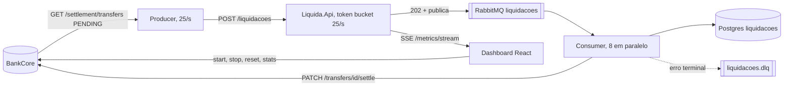

# Liquida

Pipeline de **liquidação de pagamentos** em **C# (.NET 8)**. Transferências pendentes são enviadas a uma API que respeita o limite de **25 requisições por segundo** de um parceiro de liquidação, enfileiradas no RabbitMQ e liquidadas por um consumer assíncrono, idempotente e resiliente, com retry e DLQ.

O Liquida é a metade de liquidação de um par. As transferências nascem no **[BankCore](https://github.com/GustavoQ-Mateus/bankcore)** (Go), e o Liquida as liquida e confirma de volta. Este repo também tem a única interface do conjunto: um **dashboard de tempo real** com fundo preto, uma linha de KPIs, uma grade de gráficos e um botão que dispara a simulação nos dois sistemas.



## Componentes

| Projeto | Papel |
|---|---|
| `Liquida.Api` | Minimal API: rate limit token bucket de 25/s, validação, publicação na fila e `202`. Serve as métricas do dashboard e o reset de demonstração |
| `Liquida.Producer` | Worker que busca as pendentes no BankCore (ou na tabela local), limita a si mesmo a 25/s e envia à API com Polly honrando `Retry-After` |
| `Liquida.Consumer` | BackgroundService que liquida em paralelo controlado, grava em `liquidacoes` de forma idempotente, confirma no BankCore e manda erros terminais para a DLQ |
| `Liquida.Shared` | Contratos, topologia da fila e o cliente do BankCore (token, autenticação e `settle`) |
| `web/liquida-dashboard` | Dashboard em React, Vite, TypeScript, SCSS e uPlot |

## Destaques técnicos

| Decisão | Por quê | Referência |
|---|---|---|
| Token bucket de 25/s, `429` com `Retry-After` | Respeitar o limite do parceiro. A janela fixa deixaria passar até 50 na virada da janela; o excedente recebe `429` na hora, sem acumular em memória | [ADR 0001](docs/adr/0001-token-bucket-vs-fixed-window.md) |
| Pacing no Producer | O cliente também se limita a 25/s e repete honrando `Retry-After`, em vez de depender só da recusa do servidor | [`ProducerWorker.cs`](src/Liquida.Producer/ProducerWorker.cs) |
| API só enfileira e responde `202` | A entrada fica rápida e previsível; picos ficam na fila, e nada se perde se o consumer cair | [ADR 0002](docs/adr/0002-api-enfileira-e-responde-202.md) |
| Idempotência ponta a ponta | O `id` da transferência no BankCore vira o `transacao_id`, chave primária de `liquidacoes`. A coluna `settle_confirmado_em` evita repetir a confirmação, e o `settle` repetido no BankCore é inofensivo | [spec v2.0.0 §5](docs/specs/spec-v2.0.0.md) |
| DLQ por código de erro | Erro transitório (rede, 5xx) é repetido; erro terminal (4xx) vai para a DLQ sem travar a fila. A decisão usa o `error.code` do BankCore, nunca a mensagem | [`BankCoreSettleClient.cs`](src/Liquida.Shared/BankCore/BankCoreSettleClient.cs) |
| Auth serviço a serviço | Client credentials gera um JWT de role `SETTLEMENT`, renovado antes de vencer e de novo em `401`. O Liquida só consegue ler pendentes e confirmar | [ADR 0005](docs/adr/0005-auth-servico-a-servico-com-bankcore.md) |
| Fronteira com o BankCore | Contrato HTTP explícito; cada sistema roda e é testável sozinho | [ADR 0003](docs/adr/0003-fronteira-com-bankcore.md) |
| Métricas na fonte | Contadores de negócio vêm do Postgres, profundidade de fila do RabbitMQ e `429` de um contador em memória, sem tabela de métricas para manter em sincronia | [ADR 0004](docs/adr/0004-endpoints-de-leitura-e-fontes-de-metrica.md) |
| Push por SSE | Um evento por segundo numa conexão só, com polling como fallback | [ADR 0006](docs/adr/0006-push-de-metricas-por-sse.md) |
| Dashboard em React + uPlot | Uma tela só, sem rotas; gráficos em canvas feitos para atualizar a 1 Hz | [ADR 0007](docs/adr/0007-dashboard-react-vite-uplot.md) |
| Reset de demonstração | Fecha a entrada, espera o trabalho em andamento terminar e só então esvazia fila, DLQ e tabelas, para a limpeza ficar realmente em zero | [ADR 0008](docs/adr/0008-reset-de-demonstracao.md) |
| Consumer concorrente | Liquida 8 mensagens em paralelo para acompanhar os 25/s recebidos, mantendo a idempotência | [ADR 0009](docs/adr/0009-consumer-concorrente.md) |

## Como rodar

### Os dois sistemas juntos, com o dashboard
Pré-requisitos: Docker e Node. Com este repo e o [BankCore](https://github.com/GustavoQ-Mateus/bankcore) clonados:

```bash
cd bankcore && docker compose up -d --build
cd ../Liquida && docker compose -f docker-compose.yml -f docker-compose.bankcore.yml up -d --build
cd web/liquida-dashboard && npm install && npm run dev
```

Abra `http://localhost:4200` e clique em **Iniciar simulação**. O BankCore sobe primeiro porque cria a rede `bankcore-net`, que o override do Liquida usa. O BankCore semeia no boot a credencial `svc_liquida_dev`, que o override usa por padrão, então não há passo manual. `BankCore__ClientId` e `BankCore__ClientSecret` no `.env` só servem para sobrescrevê-la, e um `.env` antigo com outra credencial passa por cima do padrão.

| Serviço | Endereço |
|---|---|
| Dashboard | http://localhost:4200 |
| Liquida.Api | http://localhost:8080 |
| BankCore | http://localhost:8081 |
| RabbitMQ (guest/guest) | http://localhost:15672 |

O dashboard usa essas URLs por padrão; para outras, defina `VITE_LIQUIDA_API_URL` e `VITE_BANKCORE_API_URL`.

### Só o Liquida, modo autônomo
```bash
docker compose up -d --build
```
Sem o override, o Producer usa a origem local: semeia 100 transações na tabela `transacoes_pendentes`, envia todas a 25/s e encerra; o Consumer liquida cada uma. Para conferir:
```bash
docker logs liquida-producer
docker exec liquida-postgres psql -U liquida -d liquida -c "select count(*) from liquidacoes;"
```

### Serviços fora do Docker
```bash
docker compose up -d rabbitmq postgres
dotnet run --project src/Liquida.Api          # http://localhost:5058
dotnet run --project src/Liquida.Consumer
dotnet run --project src/Liquida.Producer
```

## O dashboard

**Barra superior:** estado de cada fonte (ao vivo, reconectando, indisponível), fase da simulação, seletor de cenário, botão Iniciar ou Parar e a lixeira para limpar o ambiente, com confirmação. A opção **Limpar antes de iniciar** vem marcada: cada execução começa do zero nos dois sistemas.

| Cenário | Carga | O que mostra |
|---|---|---|
| Tranquilo | 40 contas, 500 transferências a 20/s | Abaixo do teto: tudo é liquidado na hora, sem fila |
| Padrão | 40 contas, 1.500 a 60/s | Acima do teto: a fila cresce e drena a 25/s |
| Estresse | 15 contas, 5.000 a 200/s | Muitas colisões de lock, fila grande e `429` |
| Personalizado | contas, transferências, taxa e workers dentro dos limites do BankCore | Os números que você escolher |

**KPIs:** liquidadas na execução, volume liquidado, recebidas por segundo contra o teto de 25, latência p95 de liquidação, backlog (pendentes no BankCore mais a fila), DLQ, integridade do ledger e colisões de lock.

**Gráficos**, numa janela de 120s, com o valor do ponto ao passar o mouse:
- vazão por segundo (criadas no BankCore, recebidas pela API e liquidadas, com a linha do teto de 25/s);
- faixa do pipeline, com as saídas de `429` e DLQ;
- backlog;
- latência de liquidação p50 e p95.

As métricas do Liquida chegam por SSE; o BankCore é consultado a cada segundo. Se uma fonte cai, os indicadores dela mostram "indisponível", as séries ficam com lacuna e o resto segue ao vivo.

## Endpoints

| Método | Rota | Uso |
|---|---|---|
| POST | `/liquidacoes` | Recebe uma transação, valida, enfileira e responde `202`. Limite de 25/s com `429` e `Retry-After: 1` |
| GET | `/metrics` | Snapshot: liquidadas, liquidadas por segundo, fila, DLQ, recebidas e `429` |
| GET | `/metrics/stream` | O mesmo snapshot por Server-Sent Events, um evento `metrics` por segundo |
| GET | `/liquidacoes/recentes`, `/transacoes/recentes` | Últimos registros (`?limite=`, até 200) |
| POST | `/simulacao/reset` | Limpa fila, DLQ, tabelas e contadores. Só com `Simulacao__ResetHabilitado=true` |
| GET | `/health` | Liveness |

Os `GET` ficam fora do rate limiter. No reset: `200` com o snapshot zerado, `409 reset_em_andamento` se já houver uma limpeza, `503 reset_nao_estabilizou` se o trabalho em andamento não parar em 20s. Durante a limpeza, `POST /liquidacoes` responde `409 simulacao_reiniciando`.

## Testes

```bash
dotnet test                                      # precisa do Docker ligado (Testcontainers)
cd web/liquida-dashboard && npm test             # Vitest
```

- **Com Postgres real (Testcontainers):** idempotência do consumer e a corrida de concorrência na barreira de idempotência, reproduzida de forma determinística.
- **Com a API em memória (WebApplicationFactory):** rate limit, leitura fora do limite e reset.
- **Unitários:** mapeamento de centavos para decimal, roteamento do `settle` por código de erro, renovação do token, SSE, contador de recebidas, validação e resiliência do Producer.
- **Front:** janela móvel e taxas derivadas, cenários e validação, sequência de limpeza e tooltip.

## Resultados medidos

Registrados nos changelogs das specs, com o BankCore ligado e a simulação disparada pelo dashboard:

| Medição | Resultado | Fonte |
|---|---|---|
| Teto de 25/s | API recebendo de 23 a 26/s em regime, média máxima em 30s de 25,4/s | [spec v2.1.0](docs/specs/spec-v2.1.0.md) |
| Consumer concorrente, cenário Padrão | Recebidas 24,06/s contra liquidadas 23,92/s, fila máxima 25, p95 de 57,95s (antes cerca de 110s) | [spec v2.2.0](docs/specs/spec-v2.2.0.md) |
| Cenário Estresse | 4.776 de 4.776 liquidadas, 5.022 colisões de lock, fila até 111, nada perdido | [spec v2.2.0](docs/specs/spec-v2.2.0.md) |
| Cenário Tranquilo | 470 de 470 liquidadas, nenhum `429`, p95 de 1,66s | [spec v2.2.0](docs/specs/spec-v2.2.0.md) |
| Limpeza com liquidações em andamento | Concluída em cerca de 15s, depois 25s com fila, DLQ e tabelas em zero | [spec v2.2.0](docs/specs/spec-v2.2.0.md) |

## Documentação

O projeto segue **Specification-Driven Development**: cada versão é uma spec aprovada antes do código, com critérios de aceitação verificados e registrados no changelog dela. Decisões de arquitetura viram ADRs, e a coordenação com o BankCore é feita por documentos de handoff e relatório.

- **Specs:** [v1.0.0](docs/specs/spec-v1.0.0.md) · [v1.1.0](docs/specs/spec-v1.1.0.md) · [v2.0.0](docs/specs/spec-v2.0.0.md) · [v2.1.0](docs/specs/spec-v2.1.0.md) · [v2.1.1](docs/specs/spec-v2.1.1.md) · [v2.2.0](docs/specs/spec-v2.2.0.md)
- **ADRs:** [0001](docs/adr/0001-token-bucket-vs-fixed-window.md) · [0002](docs/adr/0002-api-enfileira-e-responde-202.md) · [0003](docs/adr/0003-fronteira-com-bankcore.md) · [0004](docs/adr/0004-endpoints-de-leitura-e-fontes-de-metrica.md) · [0005](docs/adr/0005-auth-servico-a-servico-com-bankcore.md) · [0006](docs/adr/0006-push-de-metricas-por-sse.md) · [0007](docs/adr/0007-dashboard-react-vite-uplot.md) · [0008](docs/adr/0008-reset-de-demonstracao.md) · [0009](docs/adr/0009-consumer-concorrente.md)
- **Integração com o BankCore:** [handoff v1.1.0](docs/handoff-bankcore-v1.1.0.md) · [relatório](docs/relatorio-para-bankcore.md) · [relatório v2.0.0](docs/relatorio-para-bankcore-v2.0.0.md)

## Versões

| Versão | O que entrou |
|---|---|
| 1.0.0 | Pipeline: API com rate limit de 25/s, fila com DLQ, consumer idempotente e Producer com pacing (tag `v1.0.0`) |
| 1.1.0 | Endpoints de leitura e o primeiro dashboard, em Angular, substituído na 2.1.0 (tag `v1.1.0`) |
| 2.0.0 | Integração com o BankCore: origem das pendentes, `settle` idempotente e auth serviço a serviço (tag `v2.0.0`) |
| 2.1.0 | Métricas por SSE, contador de recebidas, credencial semeada pelo BankCore e dashboard refeito em React (tag `v2.1.0`) |
| 2.1.1 | Valor do ponto ao passar o mouse nos gráficos (tag `v2.1.1`) |
| 2.2.0 | Lixeira, cenários, limpar antes de iniciar, Producer resiliente e Consumer concorrente (tag `v2.2.0`) |

## Stack

.NET 8 · ASP.NET Core Minimal API · Dapper 2.1 · Npgsql 10 · RabbitMQ 3.13 (RabbitMQ.Client 7.2) · PostgreSQL 16 · Polly · Serilog · xUnit · Testcontainers · React 19 · Vite 8 · TypeScript 5.9 · uPlot 1.6 · Vitest 5 · Docker Compose

## Limites

Projeto de demonstração: "liquidar" é gravar em `liquidacoes` e confirmar no BankCore, sem adquirente real. A moeda é única (BRL), e o rate limit é global, não por cliente. O reset apaga dados e só existe com `Simulacao__ResetHabilitado=true`, que o compose de integração liga. As credenciais dos composes são de desenvolvimento. O dashboard roda com `npm run dev` e não tem imagem Docker. Este repo ainda não tem CI.
